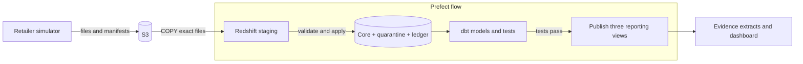

# Retail Data Platform

An end to end retail data engineering project that processes daily Parquet deliveries from S3 into Redshift, transforms and tests the data with dbt, and presents sales, product and customer metrics in Evidence. Prefect coordinates the pipeline, which demonstrates incremental loading, duplicate handling, late arriving data, invalid row quarantine and safe recovery from failures.

## Architecture



| Tool | Purpose |
| --- | --- |
| Python 3.13 / uv | Ingestion and locked dependencies |
| S3 / Parquet | Daily deliveries with exact file manifests |
| Redshift Serverless | Staging, core tables and analytics |
| Prefect | Local orchestration, retries and logs |
| dbt | Transformations and tests before publication |
| Evidence | SQL and Markdown dashboards |

- Pipeline input: an S3 manifest URI. Only the retailer simulator uses local files.
- [Data contract](docs/data_contract.md) · [Demo dataset and expected results](data/demo-v1/README.md)

## Verified results

| Check | Recorded result |
| --- | --- |
| Offline CI | [Passed on a clean checkout](https://github.com/davidom0101/end-to-end-retail-data-platform/actions/runs/45269642190), 65 pytest tests, Ruff, mypy and dbt parsing |
| Live dbt build | 8 models and 32 data tests passed |
| Failure recovery | Failed dbt test preserved reporting, retry skipped core and published the correction |
| Evidence | Clean Day 2: €386,849.69, discount correction: €386,846.69 across 4,465 eligible orders |


## Quickstart

### 1. Local checks (no AWS)

- Requires Git, uv and Python 3.13.

```bash
git clone https://github.com/davidom0101/end-to-end-retail-data-platform.git
cd end-to-end-retail-data-platform
uv sync --locked
uv run ruff format --check .
uv run ruff check .
uv run mypy
uv run pytest -q
uv run dbt parse --no-partial-parse --project-dir dbt --profiles-dir dbt/ci
```

### 2. AWS setup

| Prerequisite | Requirement |
| --- | --- |
| Tools | Node.js 22/npm, AWS CLI v2, Session Manager plugin |
| AWS | Private S3 and Redshift in one Region, default COPY role can read the bucket |
| Permissions | S3 read/list/upload, Redshift Data API and temporary database credentials |
| Connection | SSM managed EC2 instance with access to Redshift port 5439 |
| Isolation | Fresh `core_demo_<name>` and analytics schemas per scenario |

```bash
export AWS_PROFILE='<aws-profile>'
export AWS_REGION='<aws-region>'
export RETAIL_RAW_BUCKET='<raw-bucket>'
export RETAIL_REDSHIFT_WORKGROUP='<workgroup>'
export RETAIL_REDSHIFT_DATABASE='retail'
export RETAIL_CORE_SCHEMA='core_demo_portfolio'
export RETAIL_REDSHIFT_HOST='<private-workgroup-hostname>'
export RETAIL_REDSHIFT_PORT='15439'
export RETAIL_TUNNEL_INSTANCE_ID='<managed-instance-id>'
export PREFECT_SERVER_EPHEMERAL_ENABLED='true'
```

- Save as `~/.dbt/profiles.yml`:

```yaml
retail:
  target: dev
  outputs:
    dev:
      type: redshift
      method: iam_role
      iam_profile: "{{ env_var('AWS_PROFILE') }}"
      region: "{{ env_var('AWS_REGION') }}"
      host: "{{ env_var('RETAIL_REDSHIFT_HOST') }}"
      port: "{{ env_var('RETAIL_REDSHIFT_PORT') | int }}"
      dbname: retail
      schema: analytics_portfolio
      sslmode: verify-full
      threads: 1
```

- Open the tunnel in another terminal with the same environment variables:

```bash
aws ssm start-session --region "$AWS_REGION" --target "$RETAIL_TUNNEL_INSTANCE_ID" \
  --document-name AWS-StartPortForwardingSessionToRemoteHost \
  --parameters "host=$RETAIL_REDSHIFT_HOST,portNumber=5439,localPortNumber=$RETAIL_REDSHIFT_PORT"
```

- In an administrator editor, add `127.0.0.1 <private-workgroup-hostname>` to `C:/Windows/System32/drivers/etc/hosts` temporarily.

### 3. Upload and run

- Continue only when each command succeeds.

```bash
root="s3://$RETAIL_RAW_BUCKET/raw/demo-v1"
uv run dbt debug --project-dir dbt

uv run retail-pipeline upload-delivery data/demo-v1/historical/snapshot-001/manifest.json
uv run retail-pipeline upload-delivery data/demo-v1/incremental/daily-001/manifest.json
uv run retail-pipeline upload-delivery data/demo-v1/incremental/daily-002/manifest.json

uv run retail-pipeline run-deliveries "$root/snapshot-001/manifest.json"
uv run retail-pipeline run-deliveries --dataset-id demo-v1 --through 2026-11-12
```

- Upload optional scenarios using the paths in the [dataset notes](data/demo-v1/README.md).

### 4. View Evidence

- Reader access: reporting schema `USAGE` and `SELECT` on its three views, set that schema as the reader's search path.
- The connector requires an MD5 format Redshift password, TLS verification stays enabled.
- Set `EVIDENCE_SOURCE__retail__user` and `EVIDENCE_SOURCE__retail__password` locally.

```bash
cd dashboards/evidence
npm ci
export EVIDENCE_SOURCE__retail__host="$RETAIL_REDSHIFT_HOST"
export EVIDENCE_SOURCE__retail__port="$RETAIL_REDSHIFT_PORT"
export EVIDENCE_SOURCE__retail__database="$RETAIL_REDSHIFT_DATABASE"
npm run sources -- --strict
npm run dev -- --host 127.0.0.1 --port 4187
```

- Open `http://127.0.0.1:4187`, refresh sources after publication.
- After Ctrl+C, run `cd ../..` to return to the repo root.

### Cleanup

- Stop Evidence and the tunnel with Ctrl+C.
- Remove the temporary Redshift hosts file entry.
- Stop the demo tunnel instance:

```bash
aws ec2 stop-instances --region "$AWS_REGION" --instance-ids "$RETAIL_TUNNEL_INSTANCE_ID"
```

- Other retained AWS resources may still incur charges.

## Reliability

- Core changes, quarantined rows and the batch ledger commit together.
- Rerunning the same manifest skips committed core writes and resumes processing.
- Reporting updates only after dbt tests pass, failures preserve the previous published results.
- Failure demonstration: from Day 1, run `uv run retail-pipeline run-deliveries "$root/daily-002/manifest.json" --inject-failure after-commit`, then repeat without the flag.
