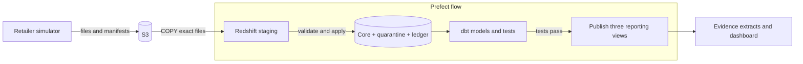
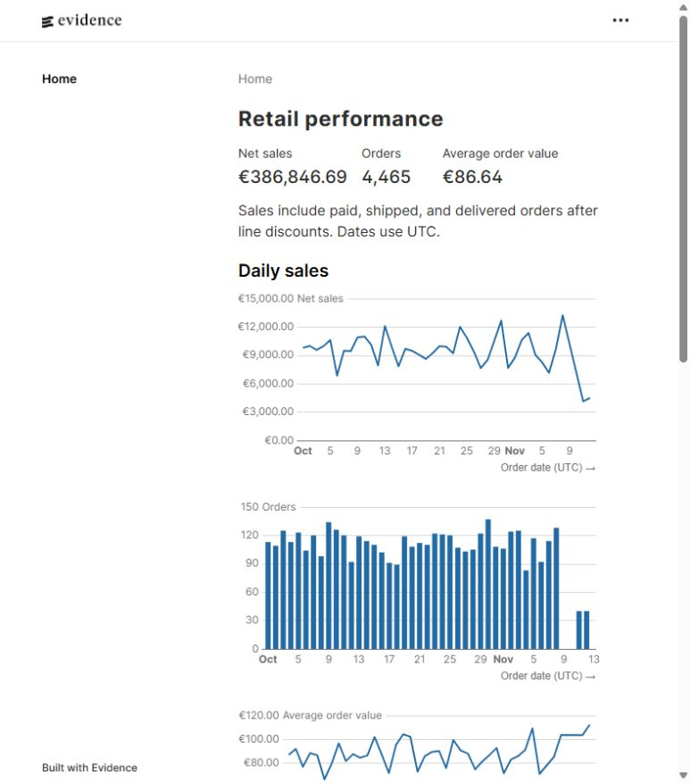

# Retail Data Platform

Retail deliveries can contain duplicate events, late orders, invalid rows and corrections that change historical sales. This project turns those deliveries into validated sales, product and customer reporting, with safe replay and failure recovery.

## Architecture



| Tool | Purpose and design choice |
| --- | --- |
| Python 3.13 / uv | Validate and ingest deliveries with locked dependencies |
| S3 / Parquet | Daily batch deliveries; manifests select exact files |
| Redshift Serverless | SQL staging, transactional core updates and analytical storage |
| Prefect | Local orchestration, task retries and run logs |
| dbt | Versioned transformations and tests before reporting publication |
| Evidence | SQL and Markdown dashboards reviewed alongside pipeline code |

- Pipeline starts at a published S3 manifest; only the standalone retailer simulator needs local dataset files.
- [Data contract](docs/data_contract.md) · [Demo dataset and expected results](data/demo-v1/README.md)

## Verified results

| Check | Recorded result |
| --- | --- |
| Offline CI | [Passed on a clean checkout](https://github.com/davidom0101/end-to-end-retail-data-platform/actions/runs/45269642190); 65 pytest tests, Ruff, mypy and dbt parsing |
| Live dbt build | 8 models and 32 data tests passed |
| Failure recovery | Deliberately failed dbt test preserved published sales; same-delivery retry skipped core and published the correction |
| Evidence | Clean Day 2: €386,849.69; discount correction: €386,846.69 across 4,465 eligible orders |



## Quickstart

### 1. Install and check without AWS

- Requires Git, uv and Python 3.13.

```bash
git clone https://github.com/davidom0101/end-to-end-retail-data-platform.git
cd end-to-end-retail-data-platform
uv sync --locked
uv run ruff format --check .
uv run ruff check .
uv run mypy
uv run pytest -q
uv run dbt parse --no-partial-parse --project-dir dbt --profiles-dir dbt/ci
```

### 2. Configure the AWS walkthrough

| Prerequisite | Requirement |
| --- | --- |
| Additional tools | Node.js 22/npm for Evidence; AWS CLI v2 and Session Manager plugin |
| AWS | Private S3 bucket; private Redshift Serverless workgroup in the same Region; default COPY role with bucket read access |
| Runner access | S3 read/list, upload permissions for the simulator, Redshift Data API and temporary database credentials |
| Private connection | SSM-managed EC2 instance reaching Redshift on 5439; dbt hostname resolves to the local tunnel while TLS retains the real hostname |
| Isolation | Fresh `core_demo_<name>` and analytics schemas for each independent walkthrough |

```bash
export AWS_PROFILE='<aws-profile>'
export AWS_REGION='<aws-region>'
export RETAIL_RAW_BUCKET='<raw-bucket>'
export RETAIL_REDSHIFT_WORKGROUP='<workgroup>'
export RETAIL_REDSHIFT_DATABASE='retail'
export RETAIL_CORE_SCHEMA='core_demo_portfolio'
export RETAIL_REDSHIFT_HOST='<private-workgroup-hostname>'
export RETAIL_REDSHIFT_PORT='15439'
export RETAIL_TUNNEL_INSTANCE_ID='<managed-instance-id>'
export PREFECT_SERVER_EPHEMERAL_ENABLED='true'
```

- Save as `~/.dbt/profiles.yml` (dbt's default location).

```yaml
retail:
  target: dev
  outputs:
    dev:
      type: redshift
      method: iam_role
      iam_profile: "{{ env_var('AWS_PROFILE') }}"
      region: "{{ env_var('AWS_REGION') }}"
      host: "{{ env_var('RETAIL_REDSHIFT_HOST') }}"
      port: "{{ env_var('RETAIL_REDSHIFT_PORT') | int }}"
      dbname: retail
      schema: analytics_portfolio
      sslmode: verify-full
      threads: 1
```

- In another terminal with the same environment variables, leave this tunnel running:

```bash
aws ssm start-session --region "$AWS_REGION" --target "$RETAIL_TUNNEL_INSTANCE_ID" \
  --document-name AWS-StartPortForwardingSessionToRemoteHost \
  --parameters "host=$RETAIL_REDSHIFT_HOST,portNumber=5439,localPortNumber=$RETAIL_REDSHIFT_PORT"
```

- For dbt on Windows, temporarily add `127.0.0.1 <private-workgroup-hostname>` to `C:/Windows/System32/drivers/etc/hosts` using an administrator editor.

### 3. Publish inputs and run

- Run commands individually; continue only when each succeeds.

```bash
root="s3://$RETAIL_RAW_BUCKET/raw/demo-v1"
uv run dbt debug --project-dir dbt

uv run retail-pipeline upload-delivery data/demo-v1/historical/snapshot-001/manifest.json
uv run retail-pipeline upload-delivery data/demo-v1/incremental/daily-001/manifest.json
uv run retail-pipeline upload-delivery data/demo-v1/incremental/daily-002/manifest.json

uv run retail-pipeline run-deliveries "$root/snapshot-001/manifest.json"
uv run retail-pipeline run-deliveries --dataset-id demo-v1 --through 2026-11-12
```

- Upload optional scenarios using the paths in the [dataset notes](data/demo-v1/README.md).

### 4. View Evidence

- Configure a dedicated reader: reporting-schema `USAGE`, `SELECT` on the three published views, and that schema on its search path; no core-table access.
- The pinned Evidence connector requires a reader password stored in Redshift's MD5 format; TLS verification remains enabled.
- Set `EVIDENCE_SOURCE__retail__user` and `EVIDENCE_SOURCE__retail__password` locally.

```bash
cd dashboards/evidence
npm ci
export EVIDENCE_SOURCE__retail__host="$RETAIL_REDSHIFT_HOST"
export EVIDENCE_SOURCE__retail__port="$RETAIL_REDSHIFT_PORT"
export EVIDENCE_SOURCE__retail__database="$RETAIL_REDSHIFT_DATABASE"
npm run sources -- --strict
npm run dev -- --host 127.0.0.1 --port 4187
```

- Open `http://127.0.0.1:4187`; refresh sources after each successful publication.
- After stopping the preview with Ctrl+C, run `cd ../..` to return to the repository root.

### 5. End the session

1. Stop Evidence and the Session Manager tunnel with Ctrl+C in their respective terminals.
2. Remove the temporary Redshift hostname entry from the administrator-managed hosts file.
3. Stop the dedicated demo tunnel instance when finished:

```bash
aws ec2 stop-instances --region "$AWS_REGION" --instance-ids "$RETAIL_TUNNEL_INSTANCE_ID"
```

- Existing S3, EC2 storage and Redshift resources remain billable after session cleanup.

## Transaction and replay behavior

| Boundary | Behavior |
| --- | --- |
| Delivery | Immutable S3 objects; source manifest published last; COPY reads only listed files |
| Core commit | Lock ledger/core; validate and classify; accepted rows, quarantine and applied-batch ledger commit together |
| Replay | Same dataset/batch and verified manifest/files skip core writes; changed content fails |
| Reporting | dbt builds candidate marts and runs tests; one transaction refreshes all three published marts |
| Failure/retry | Before commit: rollback; after commit: keep core and old reporting; rerun the same URI to resume |
| Audit | Prefect logs plus a separate warehouse audit transaction; abrupt runner termination can leave warehouse audit incomplete |
| Limits | One reporting writer per analytics schema; small Parquet parts; infrastructure provisioned separately |

- Failure demonstration: from Day 1, run `uv run retail-pipeline run-deliveries "$root/daily-002/manifest.json" --inject-failure after-commit`, then repeat without the flag.
- Verification query: `select sum(net_sales), sum(order_count) from analytics_portfolio.mart_daily_sales;`
